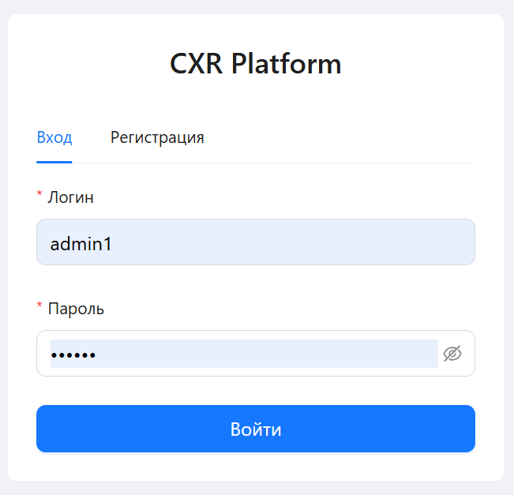
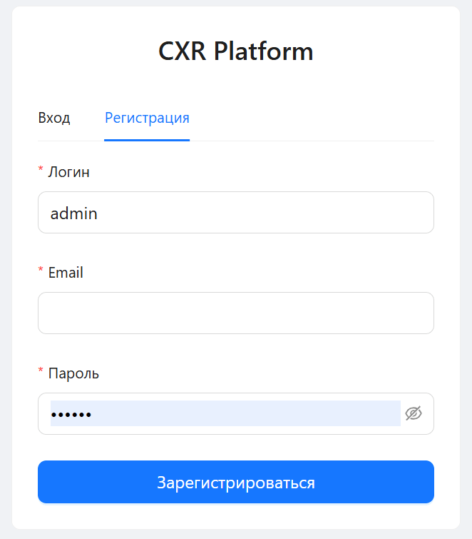
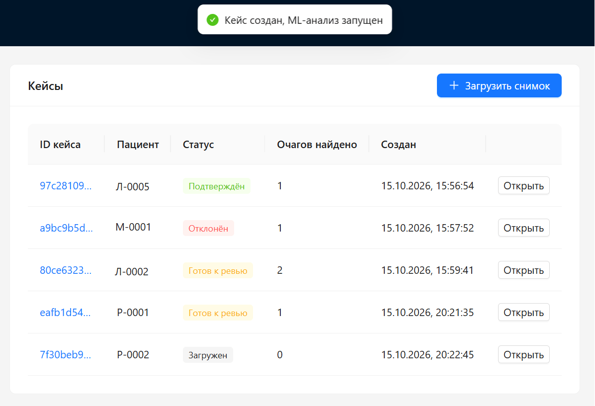
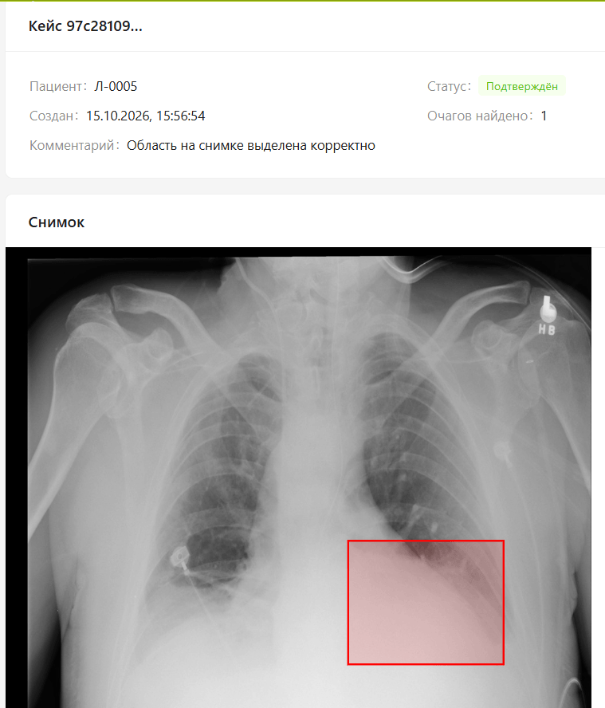
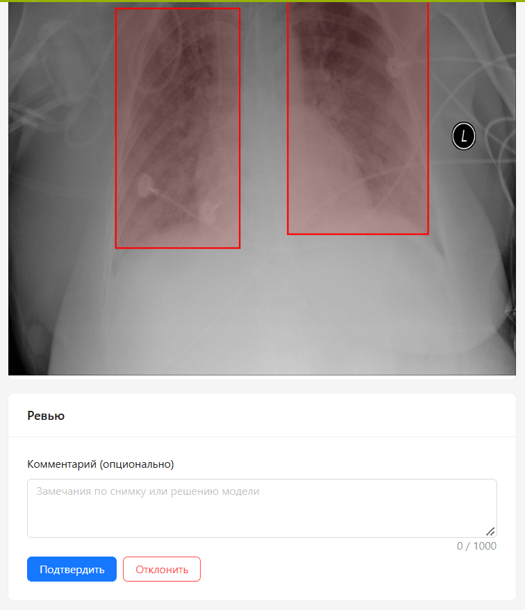
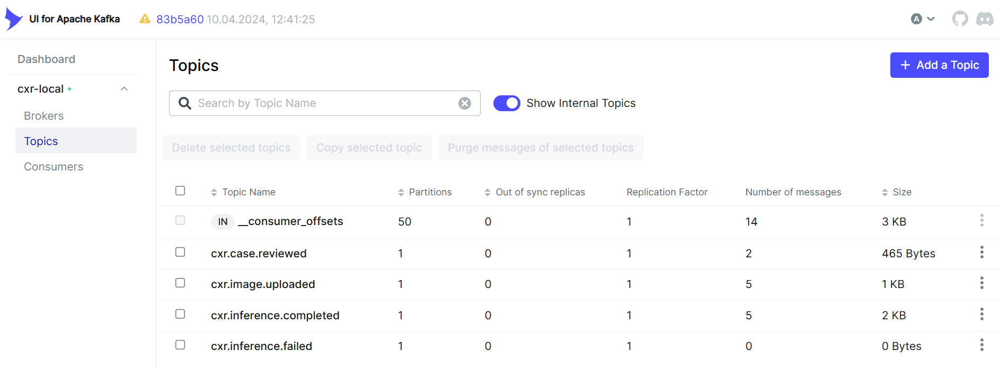
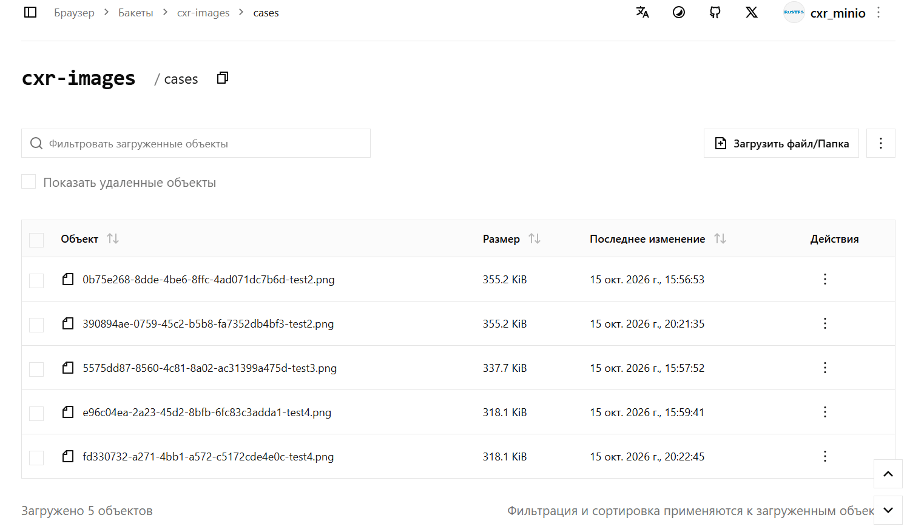

# CXR Platform — Pneumonia Review Platform

End-to-end платформа для анализа рентгеновских снимков грудной клетки: врач загружает снимок, ML-модель находит очаги пневмонии, врач проводит ревью и подтверждает или отклоняет результат.

**Стек проекта:**

- **Backend:** Java 21, Spring Boot 3.4, Spring Cloud Gateway, Spring Security, Spring Data JPA, Liquibase
- **ML:** Python 3.11, FastAPI, Ultralytics YOLOv8, PyTorch, boto3, confluent-kafka
- **Frontend:** React 18, TypeScript, Vite, Ant Design, React Query, React Router, Axios
- **Инфраструктура:** PostgreSQL 16, Apache Kafka (KRaft), RustFS (S3), Docker, Docker Compose

---

## 📖 О проекте

Классическая задача из области медицинской визуализации: **ассистировать врачу** в поиске очагов пневмонии на рентгеновских снимках. Загруженный снимок автоматически анализируется YOLO-моделью, найденные очаги отображаются на изображении, врач принимает финальное решение.

Проект построен как **набор микросервисов**, общающихся через **Kafka** (event-driven), с **единой точкой входа** через API Gateway и **JWT-аутентификацией**.

### Ключевые навыки

- Микросервисная архитектура на Spring Boot 3 (Java 21)
- Polyglot: интеграция Java-сервисов с ML-сервисом на Python
- Event-driven взаимодействие через Kafka (producer/consumer, топики, at-least-once)
- Работа с S3-совместимым хранилищем (RustFS)
- JWT-аутентификация и авторизация через Gateway
- Полноценный React-фронтенд с отображением bbox-ов поверх снимков
- Развёртывание всего стека через Docker Compose

---

## 🖼 Скриншоты

### Аутентификация

| Вход | Регистрация |
|---|---|
|  |  |

### Работа с кейсами

| Список кейсов | Детали с bbox-ами |
|---|---|
|  |  |

### Ревью

| Форма ревью |
|---|
|  |

### Инфраструктура

| Kafka UI — топики и сообщения | RustFS Console — хранилище снимков |
|---|---|
|  |  |

---

## 🚀 Быстрый старт

**Требования:** Docker Desktop, Git.

```bash
# 1. Клонировать репозиторий
git clone https://github.com/e-eki/cxr-platform.git
cd cxr-platform

# 2. Подготовить переменные окружения
cd docker
cp .env.example .env
# Открыть .env и заменить все change_me на свои значения.
# JWT_SECRET сгенерировать: openssl rand -base64 32

# 3. Запустить всё
docker compose up -d --build

# 4. Дождаться готовности (все контейнеры healthy, кроме kafka-init — он exited 0)
docker compose ps
```

Первый запуск занимает **10–15 минут** — Docker собирает 5 образов (три Java, Python, frontend).

**Открыть в браузере:** [http://localhost:3000](http://localhost:3000)

**Демо-доступ:** логин `admin`, пароль `admin123` (создаётся автоматически в dev-профиле).

**Остановить:** `docker compose down`
**Остановить и удалить данные:** `docker compose down -v`

### Как зарегистрироваться

На странице логина есть вкладка **«Регистрация»** — введите логин, email и пароль (минимум 6 символов). После регистрации вы автоматически войдёте под новым аккаунтом с ролью `DOCTOR`.

### Доступные адреса

| Компонент | Адрес | Назначение |
|---|---|---|
| Frontend | http://localhost:3000 | Веб-интерфейс (React) |
| API Gateway | http://localhost:8080 | Единая точка входа для API |
| Kafka UI | http://localhost:8090 | Просмотр топиков и сообщений |
| RustFS Console | http://localhost:9001 | Просмотр объектного хранилища |

---

## 🔄 Поток данных

```
1. Врач логинится → получает JWT
2. Загружает снимок через UI → Gateway → case-service
3. case-service: сохраняет файл в RustFS, публикует image.uploaded в Kafka
4. ml-inference: читает событие, скачивает снимок, прогоняет YOLO
5. ml-inference: публикует inference.completed с bbox-ами
6. case-service: сохраняет predictions в БД, статус кейса → READY_FOR_REVIEW
7. Врач открывает кейс, видит bbox-ы, проводит ревью (подтвердить/отклонить)
```

Подробная схема с диаграммой — в [ARCHITECTURE.md](docs/ARCHITECTURE.md).

---

## 📦 Сервисы

| Сервис | Технология | Порт | Роль |
|---|---|---|---|
| `api-gateway` | Spring Cloud Gateway | 8080 | Единая точка входа, JWT-валидация |
| `user-service` | Spring Boot | 8082 | Регистрация, логин, JWT |
| `case-service` | Spring Boot | 8081 | Кейсы, файлы, ревью, обработка ML-результатов |
| `ml-inference` | FastAPI + YOLOv8 | 8000 | Детекция очагов пневмонии |
| `frontend` | React + TypeScript | 3000 | UI: логин, список, детали, ревью |
| `postgres` | PostgreSQL 16 | 5433 | Основная БД (user_db, case_db) |
| `kafka` | Apache Kafka (KRaft) | 9092 | Очередь событий |
| `rustfs` | RustFS (S3) | 9000 | Хранилище снимков |

---

## 🧠 ML-модель

Используется **YOLOv8s**, обученная на датасете [RSNA Pneumonia Detection Challenge](https://www.kaggle.com/datasets/poeticmage/rsna-pneumonia-detection-challenge-train-val).

| Метрика | Значение |
|---|---|
| mAP@0.5 | 0.349 |
| mAP@0.5:0.95 | 0.137 |
| Precision | 0.396 |
| Recall | 0.383 |

Модель обучена в отдельном проекте [rsna-pneumonia-yolo-pipeline](https://github.com/e-eki/rsna-pneumonia-yolo-pipeline) — там полный пайплайн подготовки данных, обучения и оценки. Веса `best.pt` (22 МБ) **не хранятся в git** — их нужно скачать отдельно и положить в `ml-inference/models/` перед началом локальной разработки. Пошаговая инструкция — в [DEVELOPMENT.md](docs/DEVELOPMENT.md#получить-веса-модели).

---

## 📁 Структура репозитория

```
cxr-platform/
├── api-gateway/          # Spring Cloud Gateway
├── user-service/         # Spring Boot — auth
├── case-service/         # Spring Boot — cases + ML results
├── ml-inference/         # FastAPI + YOLOv8
├── frontend/             # React + Vite + Ant Design
├── docker/               # docker-compose.yml, .env.example, init-databases.sql
├── docs/                 # ARCHITECTURE.md, DEVELOPMENT.md, screenshots/
└── README.md
```

---

## 📚 Документация

| Документ | Содержание |
|---|---|
| [ARCHITECTURE.md](docs/ARCHITECTURE.md) | Диаграмма, поток данных, детали сервисов |
| [DEVELOPMENT.md](docs/DEVELOPMENT.md) | Локальная разработка, стек, соглашения |

---

## 🛠 Технологии

**Backend:** Java 21, Spring Boot 3.4, Spring Cloud Gateway, Spring Security, Spring Data JPA, Liquibase, Spring Kafka

**ML:** Python 3.11, FastAPI, Ultralytics YOLOv8, PyTorch, boto3, confluent-kafka

**Frontend:** React 18, TypeScript, Vite, Ant Design, React Query, React Router, Axios

**Инфраструктура:** PostgreSQL 16, Apache Kafka (KRaft), RustFS (S3), Docker, Docker Compose

---

## 📄 Лицензия

MIT.

---

## 🙏 Благодарности

- [Ultralytics YOLOv8](https://github.com/ultralytics/ultralytics)
- [RSNA Pneumonia Detection Challenge](https://www.kaggle.com/c/rsna-pneumonia-detection-challenge)
- [RustFS](https://rustfs.com/) — открытая S3-совместимая альтернатива MinIO